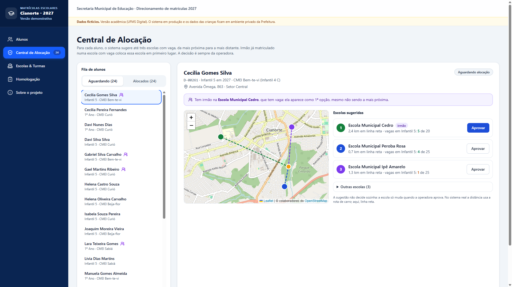
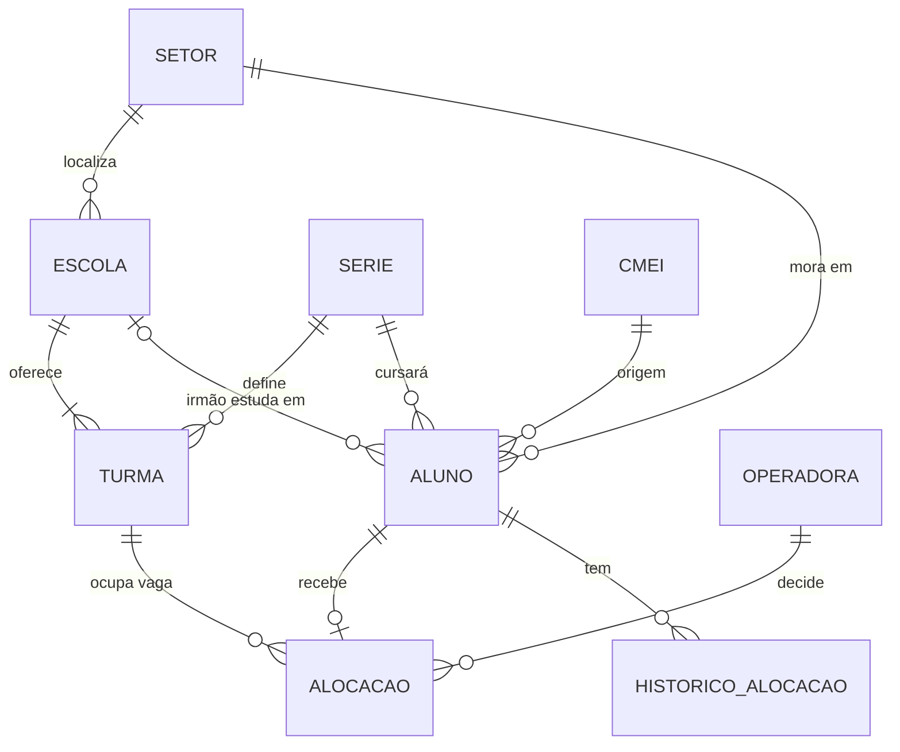

# Matrículas Escolares Cianorte — versão demonstrativa

> **Dados fictícios.** Este repositório é a versão acadêmica (UFMS Digital) de um sistema real usado pela
> Secretaria Municipal de Educação de Cianorte/PR. O sistema em produção e os dados das crianças ficam em
> ambiente privado da Prefeitura. Aqui, alunos, escolas e endereços foram **gerados por código**: nenhum registro
> vem da base real.

Aplicação web de apoio à decisão para direcionar as crianças que saem dos CMEIs às escolas municipais no ciclo de 2027.
O sistema sugere até três escolas para cada criança, considerando **distância**, **vagas na série** e **irmão já
matriculado**, e a **operadora da Secretaria decide**. Depois, as alocações são homologadas e exportadas.

Atividades do Projeto Integrador de Tecnologia da Informação (UFMS Digital, 2026/2):

- **Módulo 2 — Desenvolvimento Web com frameworks e HTML/CSS:** as telas da aplicação.
- **Módulo 3 — Banco de Dados e Controle de versão:** o modelo relacional em PostgreSQL ([`database/`](database) e
  [`docs/BANCO_DE_DADOS.md`](docs/BANCO_DE_DADOS.md)) e o fluxo de versionamento descrito em
  [Controle de versão](#controle-de-versão).



## Telas

| Tela | O que faz |
|---|---|
| **Alunos** | Totais da rodada, filtros (nome/CGM, CMEI, série, situação, irmão) guardados na URL, tabela no computador e cartões no celular. |
| **Central de Alocação** | Fila de alunos, até 3 escolas sugeridas, mapa (Leaflet/OpenStreetMap), aprovar, trocar e desfazer. |
| **Escolas & Turmas** | Ocupação de cada escola por série: já matriculados, alocados nesta rodada e vagas livres. |
| **Homologação** | Seleção dos alocados, homologação em lote e exportação da relação em CSV. |
| **Sobre o projeto** | Evolução do sistema real, decisões, acessibilidade, proteção de dados e uso de IA. |

Capturas de todas as telas, no computador e no celular, estão em [`docs/capturas`](docs/capturas).

## Tecnologias

| Camada | Escolha |
|---|---|
| Framework | [Next.js 16.4](https://nextjs.org) com App Router |
| Interface | React 19 + TypeScript 5 |
| Estilo | Tailwind CSS 4 (responsivo por pontos de quebra) |
| Mapa | Leaflet 1.9 + OpenStreetMap |
| Banco de dados | PostgreSQL 18 (SQL padrão), executado embutido pelo [PGlite](https://pglite.dev) 0.5 |
| Ícones | lucide-react |
| Testes | `node:test` (Node 24, TypeScript sem compilação) |
| Acessibilidade | axe-core 4.10 (auditoria WCAG 2.1 AA) |
| Integração contínua | GitHub Actions |

O sistema real usa a mesma base (Next.js, React, TypeScript, Tailwind) e, além disso, Supabase/PostgreSQL com
autenticação e funções transacionais, e Google Maps para endereços e rotas. Nesta versão as telas guardam as
decisões no navegador (`localStorage`), e o banco de dados é modelado e executado à parte, com os mesmos dados e as
mesmas regras (ver [Banco de dados](#banco-de-dados)). Não há chaves nem variáveis de ambiente.

## Como executar

Requisitos: Node.js 24 (os testes leem TypeScript direto) e npm.

```bash
npm install
npm run dev        # http://localhost:3000
```

Outros comandos:

```bash
npm test           # 24 testes: regras, dados, filtros, exportação e banco de dados
npm run db         # executa os scripts SQL num PostgreSQL embutido e mostra os resultados
npm run db:dados   # regenera database/02_dados.sql a partir de src/data
npm run lint       # ESLint (regras do Next.js)
npm run build      # build de produção
npm start          # serve o build
```

Não há variáveis de ambiente. Para recomeçar a demonstração, use **Reiniciar demonstração** na tela de Homologação.

## Estrutura

```
src/
  app/                 rotas (App Router): alunos, alocacao, turmas, homologacao, sobre
  components/          Shell (layout acessível) e um componente por tela
  data/                escolas e alunos FICTÍCIOS (gerados com semente fixa)
  lib/
    regras.ts          motor de sugestão (Haversine, vagas, irmão) — funções puras
    filtros.ts         filtros da lista e conversão de/para a URL
    exportar.ts        CSV da homologação
    estado.tsx         decisões da operadora (React Context + localStorage)
database/
  01_esquema.sql       tabelas, chaves, restrições, gatilhos e visões
  02_dados.sql         carga inicial fictícia (gerada por gerar-dados.ts)
  03_manipulacao.sql   INSERT, UPDATE e DELETE de um dia de trabalho
  04_consultas.sql     consultas da rodada
  05_restricoes.sql    tentativas de violar as regras, todas bloqueadas
  banco.ts, executar.ts  execução dos scripts no PGlite
tests/                 testes com node:test
docs/                  banco de dados, decisões, evolução, acessibilidade e capturas
```

## Banco de dados

Nove tabelas normalizadas (3FN): `setor`, `serie`, `cmei`, `escola`, `turma`, `aluno`, `operadora`, `alocacao` e
`historico_alocacao`. Além de chaves primárias, estrangeiras, `UNIQUE` e `CHECK`, gatilhos garantem no próprio banco
que a série da turma é a do aluno, que há vaga livre, que alocação homologada não troca de escola e que o histórico é
imutável. Duas visões calculam a ocupação das turmas e a situação de cada aluno.



`npm run db` executa os cinco scripts em ordem num PostgreSQL 18 embutido, sem instalar servidor; os mesmos arquivos
rodam num PostgreSQL comum com `psql -f`. Os testes conferem que o banco e a aplicação concordam: mesmas vagas livres e
mesmas três escolas sugeridas para cada aluno. Diagrama completo, dicionário, normalização e restrições em
[`docs/BANCO_DE_DADOS.md`](docs/BANCO_DE_DADOS.md).

## Controle de versão

- `main` guarda sempre uma versão que passa no CI; cada entrega é desenvolvida num ramo `feature/...` e entra na `main`
  por merge sem fast-forward (`--no-ff`), o que preserva no histórico o agrupamento dos commits de cada entrega.
- Commits pequenos, um assunto por commit, com mensagens no padrão
  [Conventional Commits](https://www.conventionalcommits.org/pt-br/) (`feat`, `fix`, `test`, `docs`) e corpo
  explicando o porquê.
- Cada módulo concluído recebe uma tag: `v0.1.0` (Módulo 2, telas) e `v0.2.0` (Módulo 3, banco de dados).
- O GitHub Actions verifica tipos, lint, testes, scripts SQL, build e dependências a cada envio.
- O `.gitignore` exclui dependências, builds e arquivos `.env`; nenhum dado real é versionado.

```bash
git log --oneline --graph   # histórico com os ramos e merges
git tag -n                  # entregas marcadas
```

## Regras de sugestão

1. Só escola **com vaga na série** do aluno vira opção.
2. **Irmão** numa escola com vaga → essa escola é sempre a **1ª opção**.
3. Irmão numa escola sem vaga → só um **aviso**; as opções seguem a proximidade.
4. As demais opções são as escolas **mais próximas** (linha reta, fórmula de Haversine).
5. A sugestão **não decide sozinha**: a escola só muda quando a operadora aprova.

## Acessibilidade e responsividade

- HTML semântico: `header`, `nav`, `aside`, `main`, `section`, `article`, `footer`, um `h1` por página.
- Link “Pular para o conteúdo”, foco visível, navegação completa pelo teclado.
- Tabelas com `caption` e `th scope`; todos os campos com `label`; mensagens em `aria-live`.
- Tabelas no computador, cartões no celular, menu lateral que vira menu deslizante; sem rolagem lateral de 390 px a 1920 px.
- **Auditoria axe-core (WCAG 2.1 AA + boas práticas): 0 violações nas 5 telas**, no computador e no celular.
  Detalhes em [`docs/ACESSIBILIDADE.md`](docs/ACESSIBILIDADE.md).

## Documentação

- [`docs/BANCO_DE_DADOS.md`](docs/BANCO_DE_DADOS.md): diagrama ER, entidades, normalização, restrições e scripts.
- [`docs/DECISOES.md`](docs/DECISOES.md): principais decisões de desenvolvimento e o porquê de cada uma.
- [`docs/EVOLUCAO.md`](docs/EVOLUCAO.md): linha do tempo do sistema real (repositório privado) e desta versão.
- [`docs/ACESSIBILIDADE.md`](docs/ACESSIBILIDADE.md): como a acessibilidade foi verificada e o resultado.

## Proteção de dados e uso de IA

Nenhum dado pessoal real está neste repositório. Os nomes são combinações sorteadas de listas comuns, o CGM tem
prefixo `D-`, as ruas têm nomes sintéticos (letras gregas), as escolas têm nomes de árvores e os CMEIs, de aves; um
teste automatizado confere esse padrão.

O desenvolvimento usou o **Claude Code** como ferramenta de apoio na escrita do código. Requisitos, regras, validação
das telas e aprovação das publicações foram feitos pelo estudante; os commits registram a coautoria (`Co-Authored-By`).

## Autor

Angelo Ponciano — Tecnologia da Informação, UFMS Digital.
