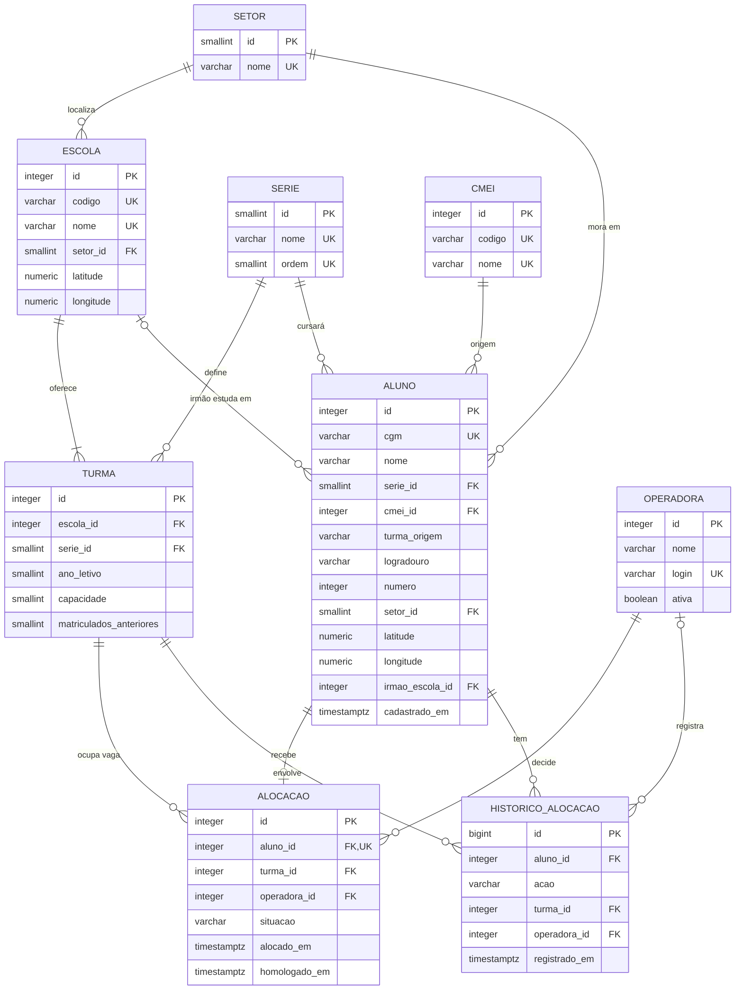

# Banco de dados

Modelo relacional da versão demonstrativa, implementado em PostgreSQL nos scripts de [`database/`](../database).
Os dados são os mesmos **fictícios** da aplicação (gerados por código a partir de `src/data`).

## Diagrama entidade-relacionamento



## Entidades

| Tabela | O que guarda | Chave natural |
|---|---|---|
| `setor` | Região da cidade, usada nos endereços de escolas e alunos | `nome` |
| `serie` | Série de destino (Infantil 5, 1º Ano) e sua ordem | `nome` |
| `cmei` | Unidade de educação infantil de onde a criança vem | `codigo` |
| `escola` | Escola municipal de destino, com coordenadas | `codigo` |
| `turma` | Vagas de uma série numa escola em um ano letivo | `(escola_id, serie_id, ano_letivo)` |
| `aluno` | Criança a ser direcionada: série, origem, endereço, irmão | `cgm` |
| `operadora` | Servidora que decide as alocações | `login` |
| `alocacao` | Decisão: a turma do aluno e a situação (alocado ou homologado) | `aluno_id` |
| `historico_alocacao` | Trilha imutável de cada ação (alocou, trocou, homologou, desfez) | — |

Todas as tabelas usam chave primária substituta (`GENERATED ALWAYS AS IDENTITY`) e mantêm a chave natural como
`UNIQUE`. Os scripts de carga e de manipulação localizam registros pela chave natural (CGM, código da escola), nunca pelo
id gerado.

## Relacionamentos e cardinalidades

- Uma **escola** oferece uma ou mais **turmas**; cada turma é de uma **série** e de um ano letivo.
- Um **aluno** vem de um **CMEI**, cursará uma **série** e mora num **setor**; pode ter irmão numa **escola** (opcional).
- Um aluno tem **no máximo uma alocação** (`UNIQUE` em `alocacao.aluno_id`): relacionamento 1:0..1. Sem alocação, o
  aluno está aguardando.
- Uma **turma** recebe várias alocações, limitadas pela capacidade (gatilho).
- Cada alocação foi decidida por uma **operadora**; cada ação gera uma linha no **histórico**.

## Normalização

- **1FN:** todos os atributos são atômicos. O endereço é dividido em logradouro, número e setor; as vagas por série
  viram linhas em `turma`, e não colunas repetidas em `escola`.
- **2FN:** as tabelas têm chave primária simples, então não há dependência parcial. Em `turma`, capacidade e
  matriculados dependem da combinação inteira escola + série + ano (chave natural composta).
- **3FN:** não há dependência transitiva. Nome do setor, da série e do CMEI ficam em tabelas próprias; a situação do
  aluno não é guardada em `aluno`, e sim derivada da existência de `alocacao` (visão `vw_situacao_aluno`); as vagas
  livres não são armazenadas, e sim calculadas (visão `vw_ocupacao_turma`), o que elimina o risco de um contador
  desatualizado.

## Restrições

| Tipo | Onde | Regra |
|---|---|---|
| `PRIMARY KEY` | todas | Identificador de cada linha |
| `FOREIGN KEY` | turma, aluno, alocacao, historico | Nenhuma referência a escola, série, CMEI, setor, turma ou operadora inexistente; aluno com histórico não pode ser apagado |
| `UNIQUE` | cgm, códigos, nomes, login, `(escola, série, ano)`, `alocacao.aluno_id` | Sem duplicidade; um aluno, uma alocação |
| `CHECK` | `aluno.cgm ~ '^D-[0-9]{5}$'` | Só aceita o CGM fictício, o que impede carregar dados reais por engano |
| `CHECK` | coordenadas, capacidade, número, ano letivo | Valores dentro de faixas válidas |
| `CHECK` | `matriculados_anteriores BETWEEN 0 AND capacidade` | Turma não começa acima da capacidade |
| `CHECK` | `(situacao = 'homologado') = (homologado_em IS NOT NULL)` | Homologação sempre com data |
| Gatilho | `validar_alocacao` | Série da turma igual à do aluno; vaga livre (com `FOR UPDATE` na turma); alocação homologada não troca de turma |
| Gatilho | `registrar_historico` | Toda inserção, troca, homologação e remoção de alocação vira uma linha no histórico |
| Gatilho | `bloquear_alteracao_historico` | Histórico só aceita inserção |

O script `05_restricoes.sql` tenta violar cada uma dessas regras e mostra o erro devolvido pelo PostgreSQL.

## Scripts

| Arquivo | Conteúdo |
|---|---|
| [`01_esquema.sql`](../database/01_esquema.sql) | `CREATE` de esquema, tabelas, índices, funções, gatilhos e visões |
| [`02_dados.sql`](../database/02_dados.sql) | Carga inicial (gerada por `npm run db:dados` a partir de `src/data`) |
| [`03_manipulacao.sql`](../database/03_manipulacao.sql) | `INSERT`, `UPDATE` e `DELETE` de um dia de trabalho |
| [`04_consultas.sql`](../database/04_consultas.sql) | Dez consultas: junções, agregações, `FILTER`, `HAVING`, `EXISTS`, CTE e função de janela |
| [`05_restricoes.sql`](../database/05_restricoes.sql) | Doze tentativas de violar as restrições, todas bloqueadas |

## Como executar

Sem instalar nada além das dependências do projeto (PostgreSQL 18 embutido via [PGlite](https://pglite.dev)):

```bash
npm install
npm run db          # executa os 5 scripts em ordem e mostra o resultado de cada consulta
npm run db -- 03    # para depois do 03_manipulacao.sql
npm test            # inclui os testes do banco (tests/banco.test.ts)
```

Num servidor PostgreSQL comum (versão 13 ou superior):

```bash
createdb matriculas_demo
for f in database/0*.sql; do psql -d matriculas_demo -v ON_ERROR_STOP=1 -f "$f"; done
```

## Relação com a aplicação

As telas ainda guardam as decisões no navegador (`localStorage`). O banco reproduz o mesmo estado inicial e as mesmas
regras, e os testes garantem que os dois concordam: a visão de ocupação dá as mesmas vagas que `vagasDaSerie()`, e a
consulta C7 sugere as mesmas três escolas que `avaliarAluno()` para cada aluno aguardando. Ligar as telas ao banco é o
próximo passo (ver [`DECISOES.md`](DECISOES.md), decisão 13).
